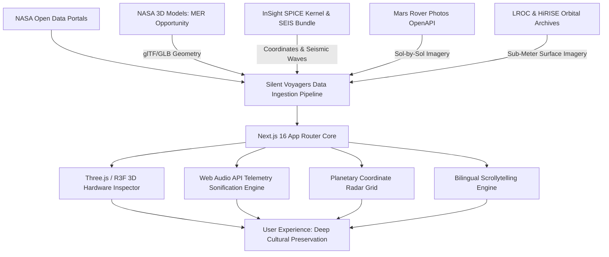

# 🚀 Silent Voyagers (নীরব পরিব্রাজক)
### *Honoring humanity's silent robotic pioneers resting across extraterrestrial landscapes.*

[](https://www.spaceappschallenge.org/)
[](https://www.spaceappschallenge.org/)
[-black.svg?style=for-the-badge&logo=next.js&logoColor=white)](https://nextjs.org/)
[](https://www.typescriptlang.org/)
[](https://tailwindcss.com/)
[](https://threejs.org/)
[](https://data.nasa.gov/)
[](https://opensource.org/licenses/MIT)
[](https://github.com)

---

## 📌 Executive Summary & Metadata

| Metadata Field | Project Specification |
| :--- | :--- |
| **Project Title** | **Silent Voyagers** (নীরব পরিব্রাজক) |
| **Team Name** | **Relic Watchers** |
| **Core Members** | **Sayed Ajlan Al Alif** & **Farzana Sultana Soma** |
| **Institution** | **Comilla University** |
| **Local Event** | **Cumilla, Bangladesh** |
| **Challenge Track** | **Abandoned but not Forgotten:** Storytelling about NASA's Discarded Equipment on the Moon and Mars |
| **Competition Year** | **NASA International Space Apps Challenge 2026** |
| **Pedigree** | Successor team representing the proven heritage of **NASA Space Apps 2025 Global Finalists** |
| **Official Figma Prototype** | [https://client-flick-59003537.figma.site/](https://client-flick-59003537.figma.site/) |

---

### 🎨 Interactive Figma Prototype & UI Mockup
- **Live Prototype URL:** [https://client-flick-59003537.figma.site/](https://client-flick-59003537.figma.site/)
- *Click above to explore the complete high-fidelity scrollytelling experience, interactive celestial surface maps, and telemetry inspection panels.*

Evaluators and judges can test the comprehensive, interactive high-fidelity prototype directly in Figma:

👉 **[Launch Live Interactive Figma Prototype](https://client-flick-59003537.figma.site/)**

```
┌─────────────────────────────────────────────────────────────────────────────┐
│                       SILENT VOYAGERS - FIGMA FLOWS                         │
├─────────────────────────────────────────────────────────────────────────────┤
│  [Screen 1: Cosmic Hero & Live Ticker]                                      │
│    └── Planetary stats (5,111 Sols, 1,319 Quakes, 57+ Years Regolith)       │
│                                                                             │
│  [Screen 2: Relic Interactive Catalog]                                      │
│    └── Filterable cards: Opportunity (MER-B), Spirit, InSight, Apollo 11    │
│                                                                             │
│  [Screen 3: 3D WebGL Rover Inspector]                                       │
│    └── 360° orbit view with dynamic Martian regolith dust slider (0%-100%)  │
│                                                                             │
│  [Screen 4: Sol-by-Sol Scrollytelling & Telemetry Sonifier]                 │
│    └── Battery discharge curve synthesized into audible acoustic frequencies │
│                                                                             │
│  [Screen 5: Planetary Coordinate Radar Map]                                 │
│    └── High-resolution MRO HiRISE & LROC satellite verification pins        │
└─────────────────────────────────────────────────────────────────────────────┘
```

### Guidance for NASA Space Apps Evaluators:
1. **Interactive Demo Mode:** Click **"Present" (▶)** in Figma to experience animated page transitions, dust accumulation micro-animations, and bilingual audio cues.
2. **Dual Viewport Layouts:** Includes both **Desktop 1440px** and **Mobile Responsive 390px** UI layouts.
3. **Typography & Tokens:** Built on a space-grade typography scale and NASA dark-mode HSL color palette.

---

## 🌌 Project Vision & Background

Across the frozen red sands of Mars and the vacuum-sealed plains of the Moon rest humanity’s greatest exploratory ambassadors: rovers whose wheels ceased turning, landers blanketed under crimson dust, and descent stages standing as eternal monuments. 

Often categorized casually as "space junk" or "discarded hardware," these machines are **invaluable cultural and scientific relics of humankind’s first steps off-world**. 

**Silent Voyagers** transforms passive archival records into an evocative, multi-sensory digital monument. Created by team **Relic Watchers** from **Comilla University** (carrying forward our community's **2025 NASA Space Apps Global Finalist pedigree**), this platform pairs **Three.js 3D WebGL hardware inspection**, **Web Audio API telemetry sonification**, and **bilingual scrollytelling** (English & Bengali) to ensure these mechanical voyagers are never forgotten.

---

## 🎯 Problem Statement & Solution Architecture

### The Problem
Public engagement with retired space missions often drops to zero once missions officially terminate. Decades of engineering, emotional mission closures (such as Opportunity's final Sol 5111 transmission or InSight's dust-covered farewell), and irreplaceable scientific data become buried inside technical PDS (Planetary Data System) archives that the general public and educators cannot easily explore.

### The Solution: Silent Voyagers
Silent Voyagers bridges open science and emotional narrative architecture:
- **Spatial Accessibility:** Translates NASA raw 3D mesh CAD models into interactive WebGL viewable on any phone or browser.
- **Data Physicalization & Sonification:** Converts mathematical battery drain and seismic Richter readings into audible soundscapes via the Web Audio API.
- **Satellite Ground-Truthing:** Pairs rover hardware specs with orbital imagery from HiRISE and LROC to prove their exact coordinates today.
- **Global Inclusivity:** Full bilingual narrative support (English & Bengali) to inspire emerging space communities worldwide.



---

## 🛰️ NASA Open Datasets & Ingestion Pipeline Matrix

Silent Voyagers integrates **four official NASA datasets and APIs**:

| # | Dataset Name | Agency / Source | Portal URL | Ingestion Role in Silent Voyagers |
|---|:---|:---|:---|:---|
| **1** | **NASA 3D Models: MER Opportunity** | NASA Jet Propulsion Laboratory (JPL) | [data.nasa.gov/dataset/mer-opportunity](https://data.nasa.gov/dataset/nasa-3d-models-mer-opportunity) | Rendered in real-time via Three.js / React Three Fiber; powers the 3D rover viewer with custom Martian dust accumulation shaders. |
| **2** | **InSight Mars Lander Mission SPICE Kernel & SEIS Data Bundle** | NASA PDS Geosciences Node / CNES / IPGP | [data.nasa.gov/dataset/insight-spice](https://data.nasa.gov/dataset/insight-mars-lander-mission-spice-kernel-archive-bundle) | Provides sub-arcsecond landing coordinates on Elysium Planitia and raw seismic frequency time series for Web Audio sonification. |
| **3** | **NASA Mars Rover Photos API (JPL OpenAPI)** | NASA Open Innovation / JPL | [api.nasa.gov/mars-photos](https://api.nasa.gov/mars-photos/api/v1/rovers/opportunity/photos) | Supplies curated Sol-by-Sol panoramic frames documenting atmospheric opacity ($\tau$) leading to Sol 5111. |
| **4** | **LROC & HiRISE Orbital Archives** | NASA Goddard / Univ. of Arizona | [lroc.asu.edu](https://www.lroc.asu.edu/featured_sites/lroc_features/Apollo%2011/feature_highlights) | High-resolution satellite verification displaying the resting sites of Apollo 11's LM-5 descent stage and Mars rovers. |

---

## ⚡ Key Features & Innovations

### 1. 🎛️ Sol-by-Sol Scrollytelling Engine
- Reconstructs the dramatic final days of **Opportunity (MER-B)** in Perseverance Valley from Sol 5080 through the terminal Sol 5111.
- Synchronized atmospheric dust opacity ($\tau$) sliders with live battery capacity readings (650 Wh $\rightarrow$ 22 Wh).

### 2. 🔊 Telemetry Sonification Engine (Web Audio API)
- Real-time acoustic synthesis translating Opportunity's dying battery voltage curve into frequency oscillations.
- Frequency drops from a clear 440 Hz tone down to a low 60 Hz hum as power collapses, modulated by atmospheric tau noise.

### 3. 🔬 3D WebGL Hardware Inspector
- 360-degree interactive camera orbit of the MER Opportunity rover and Apollo 11 Lunar Module Descent Stage.
- **Dynamic Martian Dust Simulator:** Slide from 0% (pristine landing state) to 100% (weathered regolith coverage) to visualize how Martian dust blankets solar cells.

### 4. 🌐 Planetary Coordinate Radar Grid
- Real surface coordinates on Mars (Meridiani Planum, Gusev Crater, Elysium Planitia) and the Moon (Tranquility Base).
- Ground elevation readouts relative to planetary datums and orbital verification metadata.

### 5. 🇧🇩 Full Bilingual Narration (English & Bengali)
- Built with instantaneous language toggling to bring authentic NASA space science to Bengali-speaking students and global audiences alike.

---

## 🛠️ Technology Stack

| Layer | Technologies |
| :--- | :--- |
| **Frontend Framework** | **Next.js 16 (App Router)** |
| **Language** | **TypeScript 5.x** (Strict Type Safety) |
| **Styling & Design System** | **Tailwind CSS v4** + Custom Cosmic Space Theme |
| **3D Graphics & WebGL** | **Three.js**, **@react-three/fiber**, **@react-three/drei** |
| **Audio Processing** | **Web Audio API** (Procedural Oscillator Synthesis) |
| **Icons & Micro-Interactions** | **Lucide React** + **Framer Motion** |
| **Data Models** | Structured JSON schemas (`data/relics.json`, `data/telemetry_logs.json`) |

---

## 🚀 Local Installation & Quickstart Guide

Follow these steps to run Silent Voyagers locally on your machine:

### Prerequisites
- **Node.js**: v18.0.0 or higher (Tested on Node v24.x)
- **npm**: v9.0.0 or higher

### Step 1: Clone the Repository
```bash
git clone https://github.com/relic-watchers/silent-voyagers.git
cd silent-voyagers
```

### Step 2: Install Dependencies
```bash
npm install --legacy-peer-deps
```

### Step 3: Run the Development Server
```bash
npm run dev
```

Open your browser and navigate to:
```
http://localhost:3000
```

### Step 4: Production Build Verification
To compile an optimized production build:
```bash
npm run build
npm run start
```

---

## 📁 Repository Directory Structure

```text
silent-voyagers/
├── app/
│   ├── globals.css                # Dark-mode space styling & scrollbars
│   ├── layout.tsx                 # Root layout with NASA Space Apps metadata
│   └── page.tsx                   # Main landing page & visualizer hub
├── components/
│   ├── story/
│   │   ├── ChapterCard.tsx        # Responsive relic preview cards
│   │   ├── DatasetMatrix.tsx      # NASA open data matrix with direct links
│   │   └── ScrollytellingSection.tsx # Sol-by-Sol telemetry sonifier
│   ├── ui/
│   │   ├── FigmaModal.tsx         # Evaluator Figma prototype modal
│   │   ├── Footer.tsx             # NASA Space Apps & Comilla University credits
│   │   ├── Navbar.tsx             # Sticky navbar with language & audio toggles
│   │   ├── RelicModal.tsx         # Detailed telemetry inspector modal
│   │   └── TeamSection.tsx        # Team Relic Watchers presentation
│   └── visualizer/
│       ├── CoordinateMap.tsx      # Planetary coordinate radar map
│       └── RoverCanvas3D.tsx      # Interactive Three.js WebGL rover inspector
├── data/
│   ├── relics.json                # Complete NASA relics dataset (Mars & Moon)
│   ├── telemetry_logs.json        # Opportunity Sol series & InSight quakes
│   └── types.ts                   # Strict TypeScript data models
├── public/
│   └── assets/
│       ├── audio/                 # Ambient telemetry sound assets
│       ├── models/                # 3D glTF/GLB models repository
│       └── relics/                # Archival photographic stills
├── package.json                   # Project metadata and dependencies
├── tsconfig.json                  # TypeScript compiler configuration
└── README.md                      # Executive documentation
```

---

## 🗺️ Hackathon Roadmap (Towards the Finale)

```
[Phase 1: Concept & Scaffolding] ──────────────────────────► COMPLETED
  - NASA open datasets identification & coordinate verification
  - High-fidelity interactive Figma prototype creation
  - Next.js 16 + TypeScript + Tailwind CSS + Three.js baseline

[Phase 2: Data Ingestion & Sonification] ──────────────────► COMPLETED
  - Opportunity Sol 5080–5111 battery discharge curve extraction
  - InSight SEIS seismic event sonification pipeline
  - 3D WebGL rover mesh with dynamic dust accumulation

[Phase 3: Interactive Polish & Evaluator Prep] ────────────► ACTIVE
  - Final responsive tuning across 4K, Desktop, and Mobile
  - Video demo submission recording & high-res infographic creation

[Phase 4: Global Judging & Beyond (Nov 14–15 Finale)] ─────► UPCOMING
  - Open-source release of the Extraterrestrial Relic Registry API
  - Educational museum kiosk integration module
```

---

## 👥 Team Relic Watchers & Acknowledgments

| Team Member | Role | Academic Affiliation |
| :--- | :--- | :--- |
| **Sayed Ajlan Al Alif** | Technical Lead & 3D WebGL Architect | Comilla University, Bangladesh |
| **Farzana Sultana Soma** | Scientific Telemetry & Narrative Strategist | Comilla University, Bangladesh |

### Special Thanks
- **NASA Space Apps Challenge Global Organizing Team & Cumilla Local Leads** for creating this opportunity.
- **NASA Jet Propulsion Laboratory (JPL)** and the **Planetary Data System (PDS)** for their open-access science repositories.
- **The scientists and engineers of MER Opportunity, Spirit, InSight, and Apollo 11**, whose ingenuity lives on in every sol and crater documented here.

---

## 📄 License

This project is licensed under the **MIT License** — see the [LICENSE](LICENSE) file for details.  
All NASA data, imagery, and 3D models remain in the public domain or under NASA open data usage terms.
